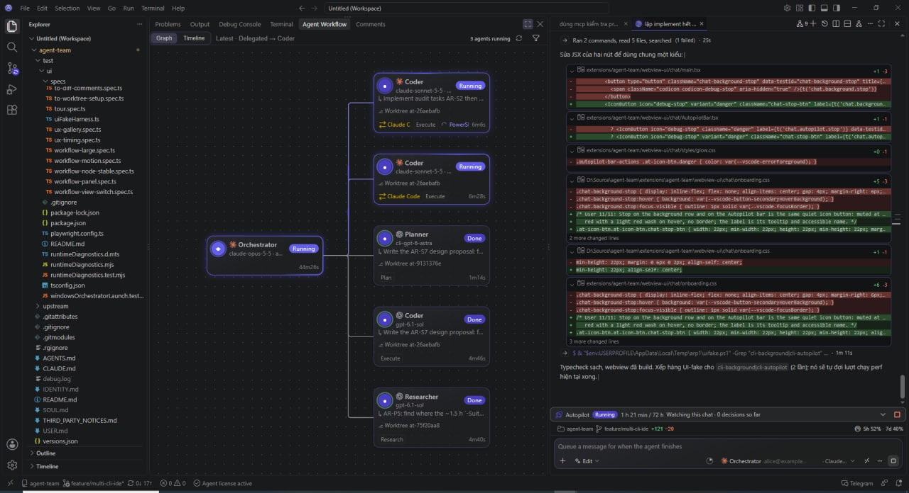
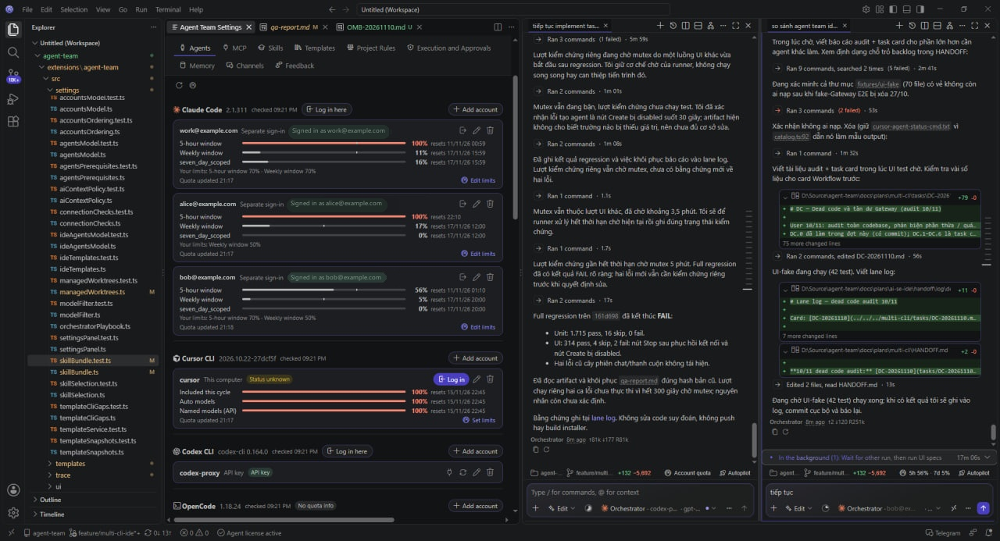
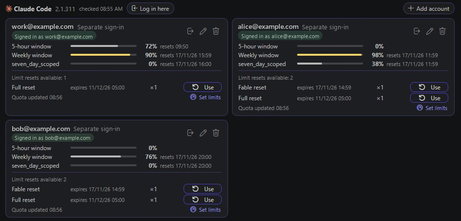
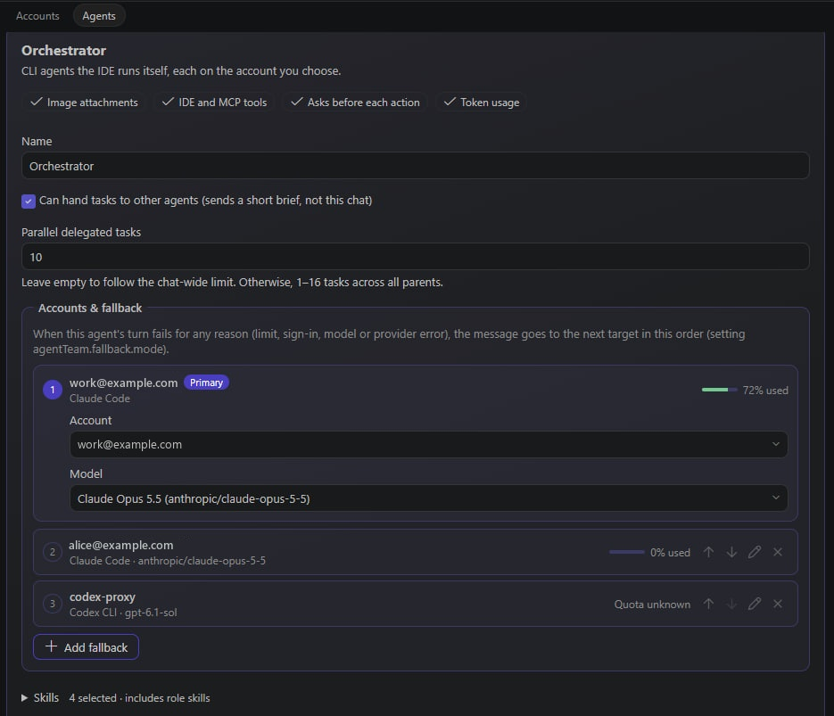
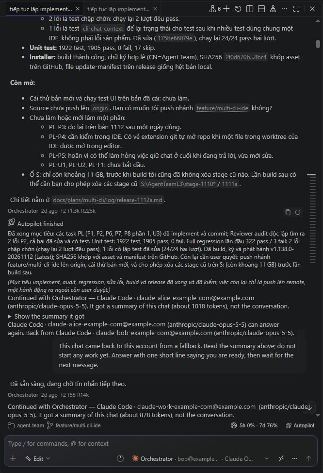
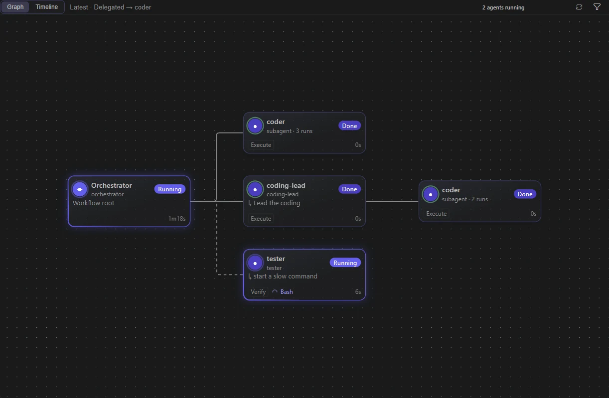
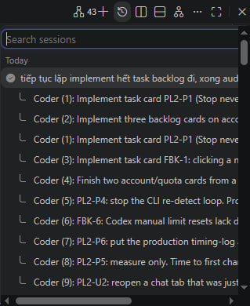
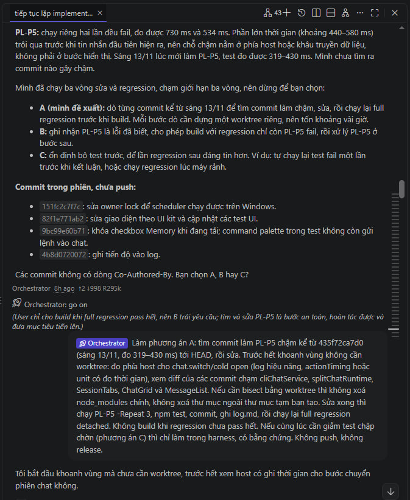
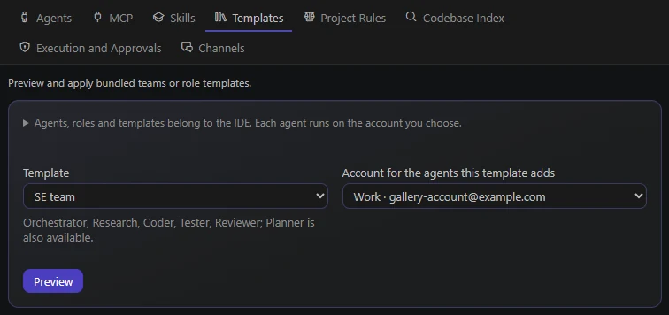

# Agent Team IDE

**Your AI engineering team, in one IDE.**

An Orchestrator and specialist AI agents running on the coding CLIs you already pay for:
Claude Code, Codex CLI, Cursor CLI, OpenCode, Antigravity and any ACP agent.

[**Download**](https://github.com/ha-vo-giang/agent-team-ide-release/releases/latest) ·
[**Website**](https://ato.io.vn) ·
[Release notes](https://github.com/ha-vo-giang/agent-team-ide-release/releases)

Early access · Windows x64 · Linux x64 / ARM64 · macOS (universal)

## Why Agent Team IDE

Coding agents are strong on one task. Real work needs several of them, on several accounts, running for hours without stalling.
Agent Team IDE is a desktop IDE (built on Code-OSS) that turns the CLIs you already use into one team:

| | |
|---|---|
| **Multi-provider** | Claude Code, Codex, Cursor CLI, OpenCode, Antigravity and ACP agents side by side. Each agent picks its own CLI, account and model. |
| **Multi-account** | Sign in to every CLI with as many accounts as you have, each with its own live 5-hour and weekly quota. |
| **Automatic fallback** | A limit, sign-in or provider error moves the chat to the next account or provider, and brings it back later. |
| **Harness templates** | One template sets up the team: roles, skills, rules, MCP servers and who may delegate to whom. |
| **Autopilot** | Hand over a long goal with a time budget. Autopilot keeps the Orchestrator moving and stops for anything risky. |
| **Shared memory** | Principles, facts and handoffs saved per workspace and recalled by every agent in every new session. |

Agent Team IDE does not replace your AI subscriptions: it drives the official CLIs you install and sign in to.

## A look inside

### Every coding CLI, in one team

Each provider shows its version, sign-in state and quota on one Settings page. Several chats run side by side, each on a different agent.

### Pool every account, and see what each one has left

Work and personal plans, team seats or API keys on the same CLI. Every account keeps its own sign-in, so two agents on one CLI can run on different accounts at once.

### Fall back automatically at the usage limit

Give each agent an ordered list of accounts and providers. When a turn fails for a limit, sign-in, model or provider error, the message goes to the next one; the chat carries a short summary along and comes back to the first account later.

### A team that delegates, in parallel

The Orchestrator hands bounded tasks to specialist agents, each in its own Git worktree when it edits code. Agent Workflow shows who works on what, live; parent and child agents can message each other while a task runs, and every child session stays one click away.

### Autopilot for long goals

Set a goal and a time budget. Autopilot reviews each answer, decides the next safe step, and leaves to you what needs a human: pushing, publishing, deleting, real sign-ins.

### Harness templates

Start from a bundled team (for example Orchestrator, Research, Coder, Tester, Reviewer) on the account you choose, then tune roles, skills, rules and MCP servers.

## Download and install

Get the files from the [latest release](https://github.com/ha-vo-giang/agent-team-ide-release/releases/latest), or from [ato.io.vn](https://ato.io.vn).

| Platform | File | Install |
|---|---|---|
| Windows x64 | `AgentTeamSetup-x64.exe` (signed) | Run the installer (per user, no admin rights needed). |
| Debian / Ubuntu x64 | `agent-team_<version>_amd64.deb` | `sudo apt install ./agent-team_<version>_amd64.deb` |
| Debian / Ubuntu ARM64 | `agent-team_<version>_arm64.deb` | `sudo apt install ./agent-team_<version>_arm64.deb` |
| Other Linux x64 / ARM64 | `agent-team-linux-<arch>-<version>.tar.gz` | Extract and run `agent-team`. |
| macOS (Apple silicon and Intel) | `Agent-Team-IDE-darwin-universal-<version>.zip` | Unzip and move the app to Applications. |

The IDE checks for updates itself and installs new releases from this repository. Each release lists its fixes, new features, checks and the SHA256 of every file.

### Before your first chat

1. Install at least one coding CLI you have a plan for (for example Claude Code, Codex CLI, Cursor CLI or OpenCode).
2. Open **Agent Team Settings › Agents**, add your accounts and sign in. The IDE runs each CLI's own sign-in; your tokens stay with the CLI.
3. Apply a template, or create your own agents, then start chatting with the Orchestrator.

## About this repository

This repository publishes the installers, packages and update manifests of Agent Team IDE. The source code is not hosted here.
Questions and feedback: use **Feedback** inside the IDE, or visit [ato.io.vn](https://ato.io.vn).

Agent Team IDE is made by [ATO](https://ato.io.vn), Vietnam.
